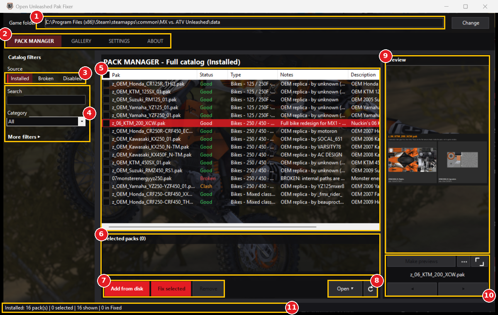
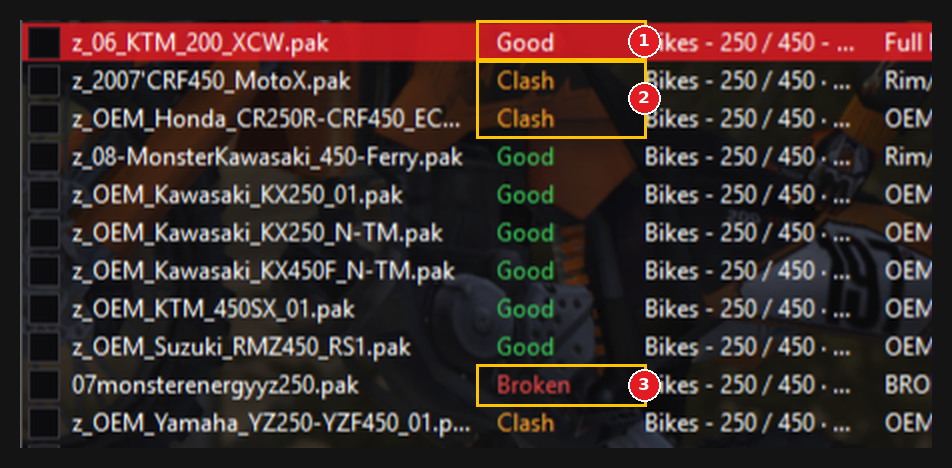
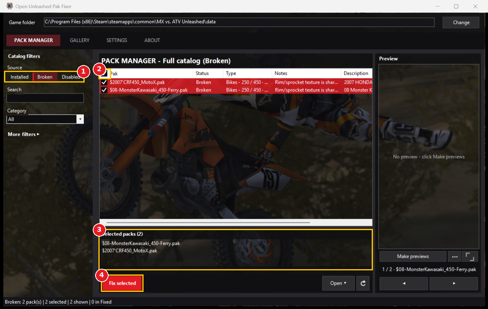
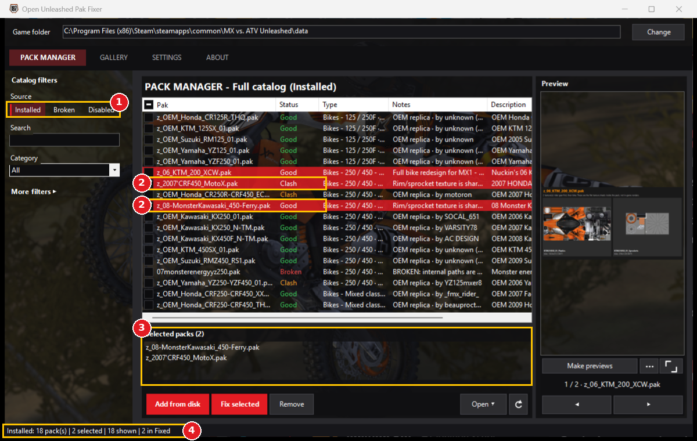
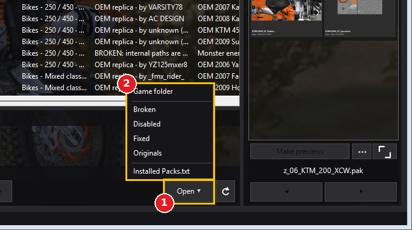
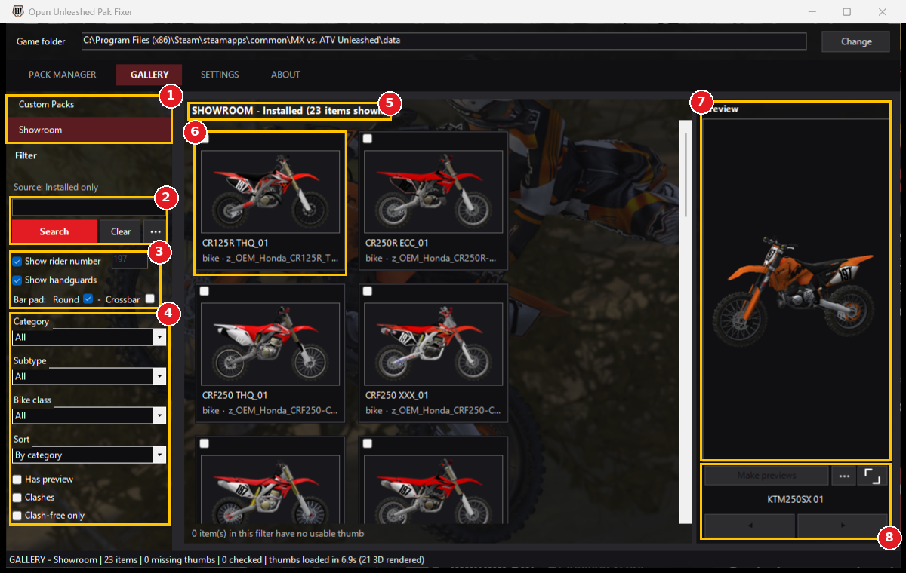

# User Guide

This guide covers what you see on startup, the **PACK MANAGER** and the **Showroom**, plus the console tools kept as a fallback. SETTINGS and ABOUT are simple enough to figure out by clicking around.

All folders below are inside the `OU Pak Fixer` folder unless it says *game folder*.

- [1. Startup](#1-startup)
- [2. PACK MANAGER](#2-pack-manager)
- [3. Showroom](#3-showroom)
- [Fallback: FIX PAKS.bat and MANAGE PACKS.bat](#fallback-fix-paksbat-and-manage-packsbat)

## 1. Startup

Run **`OPEN UI.bat`**. The app opens on **PACK MANAGER > Installed**, which lists the mod paks in your game right now.

1. **Game folder**: the game's `data` folder, where installed paks live. It is found automatically. Click **Change** to pick another one.
2. **Tabs**: PACK MANAGER, GALLERY (Showroom), SETTINGS and ABOUT.
3. **Source**: which paks you are looking at.
   - **Installed**: paks in the game folder.
   - **Broken**: paks waiting to be fixed (`Pack Files\Broken`).
   - **Disabled**: paks kept out of the game (`Pack Files\Disabled`).
4. **Filters**: Search, Category and **More filters** (sort, bike class, has preview, clashes, clash-free only).
5. **Pak list**: one row per pak, with its status in the second column. Drag a column edge to resize it. The header checkbox ticks every row shown.
6. **Selected packs**: everything you have ticked. The buttons only act on ticked paks.
7. **Action buttons**: these change with the Source (see section 2).
8. **Open** menu (opens any pak folder in Explorer) and the rescan button (or press F5).
9. **Preview** of the row you clicked. Previews are saved in `Pack Manager\Previews`.
10. **Make previews** for the ticked paks, **...** (delete previews), full screen, and arrows to step through paks.
11. **Status bar**: counts and the result of the last action.

> **Tick vs. click:** ticking a checkbox chooses what the buttons act on. Clicking a row only shows its preview.

## 2. PACK MANAGER

### Status tags

1. **Good** (green): ready to go.
2. **Clash** (orange): another installed pak replaces the same item, so only one can show in game. Here two paks both replace the CRF450R ECC plastics. Keep the one you want and **Remove** the other.
3. **Broken** (red): the pak needs fixing. Common causes are bad texture headers, files stored under the wrong folder inside the pak, or a name that loads before the game's own files (for example one starting with `$`).

### Fixing broken paks

**Before:**

1. Put downloaded paks in `Pack Files\Broken` (**Open > Broken** takes you there), then click **Broken**.
2. Tick the paks you want. The header checkbox ticks them all.
3. Check the list under **Selected packs**.
4. Click **Fix selected**:
   - **Yes**: fix and install into the game.
   - **No**: fix only. The paks go to `Pack Files\Disabled`.
   - **Cancel**: do nothing.

**After:**

1. The app switches back to **Installed**.
2. The two fixed paks are now in the game. They were renamed so they load after the game's own files (`$2007'CRF450_MotoX.pak` became `z_2007'CRF450_MotoX.pak`). One is **Good**. The other shows **Clash**, because an installed pak already replaces the same bike.
3. They are still ticked under **Selected packs**.
4. The status bar shows the result.

- A copy of each fixed pak is kept in `Pack Files\Fixed`, and the untouched original goes to `Pack Files\Originals`.
- If the game is running, the fixer waits for you to close it.

### Installed buttons
- **Add from disk**: pick `.pak` files anywhere on your PC. They are fixed and installed in one go.
- **Fix selected**: fix the ticked installed paks in place.
- **Remove**: move the ticked paks out of the game into `Pack Files\Disabled`. Nothing is deleted.

### Disabled paks
**Disabled** lists the paks in `Pack Files\Disabled`. Tick them and click **Install selected** to put them back in the game; they are fixed on the way in if needed.

The included skin, Nuckin's 06 KTM 200 XC-W (`z_06_KTM_200_XCW.pak`), ships here. Tick it and click **Install selected**, then pick the **KTM 250 SX** in game.

### Where everything lives

1. **Open** opens a menu with every folder the app uses.
2. Pick one to open it in Explorer.

| Menu item | Folder | What's in it |
|---|---|---|
| Game folder | the game's `data` folder | installed paks |
| Broken | `Pack Files\Broken` | paks waiting to be fixed |
| Disabled | `Pack Files\Disabled` | paks kept out of the game |
| Fixed | `Pack Files\Fixed` | copies of fixed paks |
| Originals | `Pack Files\Originals` | untouched originals |
| Installed Packs.txt | `Pack Manager\` | text list of installed paks |
| (previews) | `Pack Manager\Previews` | preview images and 3D renders |

## 3. Showroom

Open **GALLERY > Showroom** and press **Search**. Every bike livery and gear item in your installed paks gets its own card.

1. **Rail**: Showroom, and Custom Packs (coming soon).
2. **Search** box, **Search**, **Clear**, and **...** (make all missing previews, reload thumbnails). The grid stays empty until you press Search.
3. **Rider preview**: rider number (blank = the number from your save), hand guards, and bar pad Round or Crossbar. This only affects the preview; your game save is never touched. The same controls are on the SETTINGS tab.
4. **Filters**: Category, Subtype, Bike class, Sort, Has preview, Clashes, Clash-free only.
5. How many items match, and **Tick all**: ticks every card shown, or unticks them all when they are all ticked.
6. **Card**: click it to preview. It shows the bike and livery it replaces (for example `CR125R THQ_01`), the slot type and the source pak. Its checkbox ticks it for Make previews.
7. **3D preview** of the selected bike with your rider settings. Here: Nuckin's 06 KTM 200 XC-W on the KTM 250 SX.
8. **Make previews**, **...**, full screen, and arrows to step through cards.

Set **Category** to **Rider gear** and press **Search** again to see helmets, jerseys, goggles and boots. Gear previews show the texture itself.

3D renders are cached in `Pack Manager\Previews`, so they load instantly next time.

## Fallback: FIX PAKS.bat and MANAGE PACKS.bat

These two console tools are the original working concepts behind the Pak Fixer. They are kept in case the window app ever breaks:

- **`FIX PAKS.bat`**: fixes everything in `Pack Files\Broken` and asks whether to install it (the same fixer as **Fix selected**).
- **`Pack Manager\MANAGE PACKS.bat`**: a numbered menu to turn paks on and off, fix installed paks, make previews and save loadouts.

Both use the same folders as the app, so you can switch between them freely.
