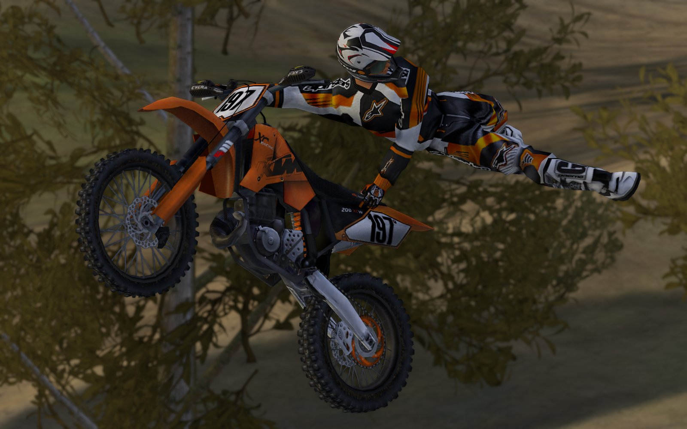
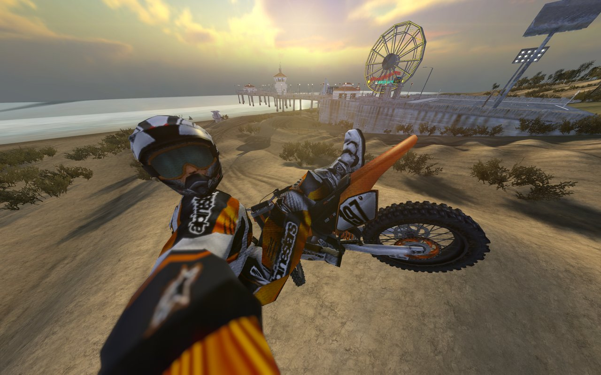
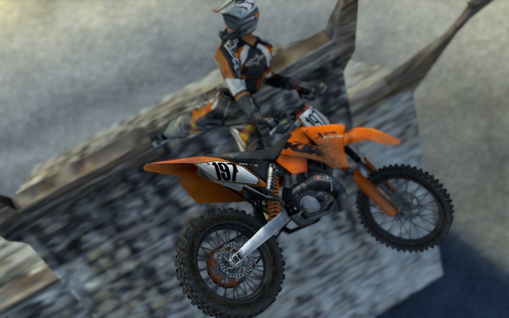
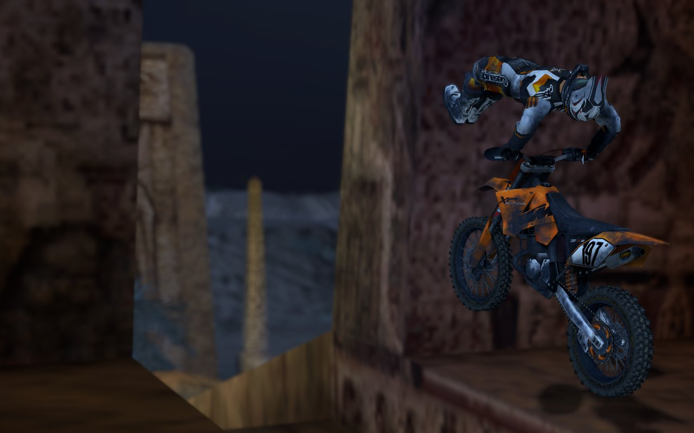
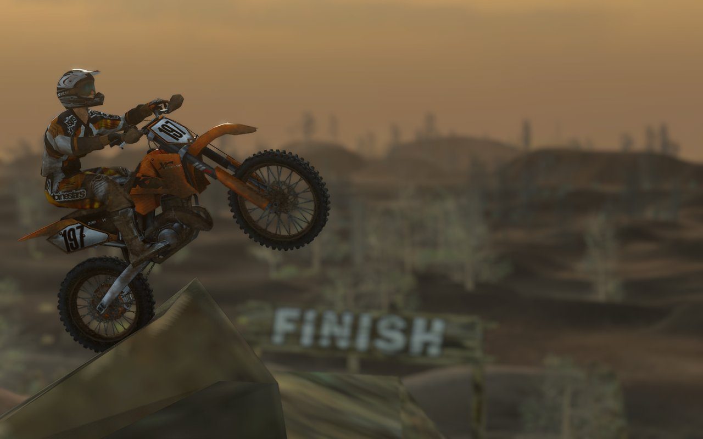
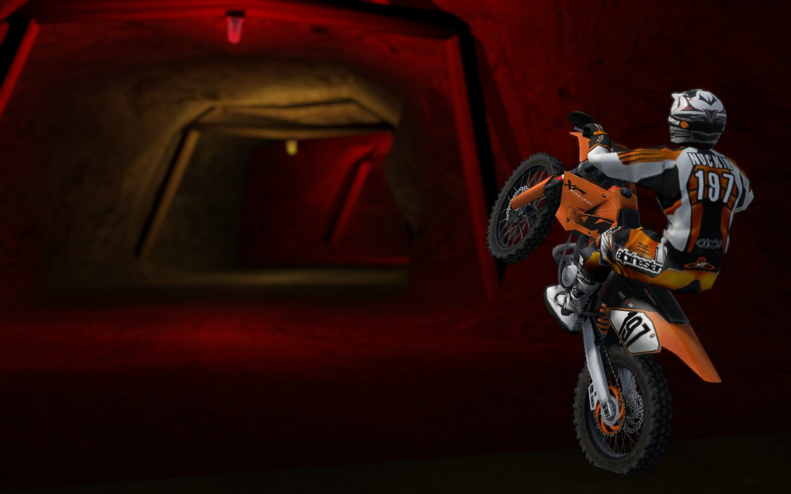
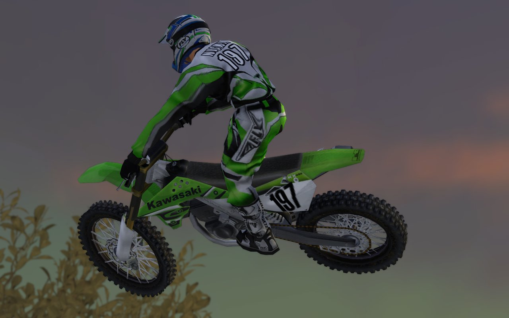

# Open Unleashed Pak Fixer

A Windows app for **MX vs ATV Unleashed / Open Unleashed** `.pak` mods. It fixes broken paks, installs and removes them, warns about clashes, and previews every bike and gear item in a 3D Showroom.

  

On the release page, scroll to **Assets** and click the **.zip** file.

**How to use it:** see the [User Guide](GUIDE.md).

## Requirements
- Windows 10 or 11 (PowerShell 5.1 is built in)
- MX vs ATV Unleashed (Steam) / Open Unleashed

## Install
1. Download the .zip from the [latest release](https://github.com/ITGDOTFFTIOW/OU-Pak-Fixer/releases/latest).
2. Right-click the zip > **Properties** > tick **Unblock** > **OK**.
3. Extract it anywhere. You get one folder, `OU Pak Fixer`.
4. Run **`OPEN UI.bat`** in that folder. To add a desktop icon, use **SETTINGS > Create desktop shortcut**.

## Quick start
1. Run **`OPEN UI.bat`**. The game's `data` folder is found automatically (click **Change** on the top bar if it is wrong).
2. Put downloaded `.pak` files in `Pack Files\Broken`.
3. **PACK MANAGER > Broken**: tick the paks, click **Fix selected**, then **Yes** to install them. The app switches to **Installed** with the fixed paks ticked.
4. **GALLERY > Showroom > Search** previews every installed bike and gear item.

The included skin, Nuckin's 06 KTM 200 XC-W (`z_06_KTM_200_XCW.pak`), is in `Pack Files\Disabled`. Install it from **PACK MANAGER > Disabled > Install selected**, then pick the **KTM 250 SX** with the **Team KTM 250** livery in game.

## In game

Nuckin's clean 06 KTM 200 XC-W (`z_06_KTM_200_XCW.pak`, included in the zip) working in game. It replaces the Team KTM 250 livery on the KTM 250 SX.

<table>
  <tr>
    <td width="50%" align="center"> Beach and pier</td>
    <td width="50%" align="center"> Superman over the trees</td>
  </tr>
  <tr>
    <td width="50%" align="center"> Stone wall</td>
    <td width="50%" align="center"> Canyon at night</td>
  </tr>
  <tr>
    <td width="50%" align="center"> Wheelie at the finish</td>
    <td width="50%" align="center"> Red tunnel wheelie</td>
  </tr>
  <tr>
    <td colspan="2" align="center"> <code>z_OEM_Kawasaki_KX450F_N-TM.pak</code> (KX450F, N-TM 01 livery) working in game</td>
  </tr>
</table>

## Credits and thanks
The included skin, Nuckin's 06 KTM 200 XC-W, is by NuckinFutz197. Thanks to the community skin creators and to the MVA Unleashed Mod Collection. See [CREDITS.md](CREDITS.md).

All rights reserved.

## FAQ
Questions and troubleshooting are in [FAQ.txt](OU%20Pak%20Fixer/FAQ.txt), which is also in the `OU Pak Fixer` folder.
